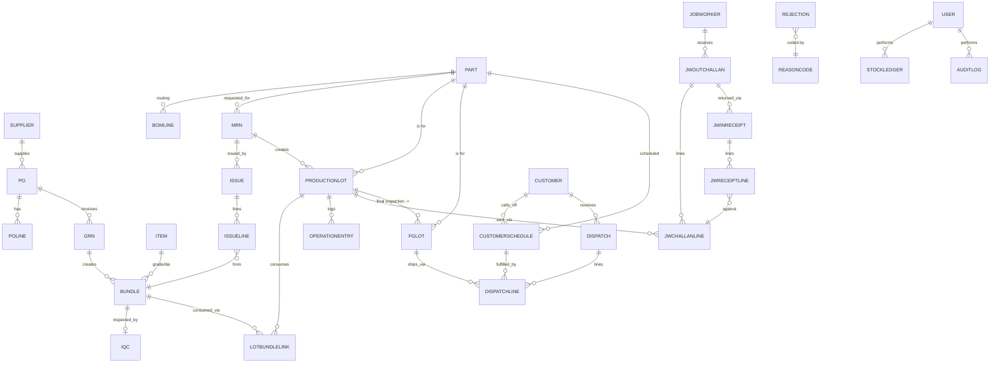

# Architecture

## Entity-relationship diagram



Every box above that represents a physical stock unit (`Bundle`,
`ProductionLot`, `FgLot`) also has a 1:N relationship to `StockLedger` via
its human-readable number (`refNo`) — drawn separately here because the
ledger links by string key, not FK, so that a ledger row always survives
even if (hypothetically) a unit row were ever archived.

## Stock ledger / transaction design

`StockLedger` is the single source of truth (mandatory rule #1). Every one
of the 17 transaction types (T1-T17, schema enum `TxnType`) writes exactly
one row per stock-affecting movement:

```
txnId (UUID) · txnType · txnDate · docNo · itemType (RM/WIP/FG) · refNo
fromLocationId? · toLocationId? · fromStatus? · toStatus?
qty · uom · userId · reason?
```

Every service function in `src/server/services/*` that moves stock:

1. Opens a Prisma `$transaction` at `Serializable` isolation (SQLite runs
   one write transaction at a time, so concurrent writers are serialized).
2. Updates the denormalized balance column (`Bundle.balanceKg`,
   `ProductionLot.qtyNos`, `FgLot.balanceNos`) — kept denormalized purely
   for fast reads (dashboard KPIs, issue-screen pool queries).
3. Writes the matching `StockLedger` row via `writeLedger()`.
4. Commits both writes atomically. If step 2 or 3 throws (e.g. would go
   negative), the whole transaction rolls back — nothing is half-applied.

Reports (Section 8) read **only** from `StockLedger` for anything derived
(stock summary inward/outward, aging — aging uses `inwardDate`/`startDate`
on the unit row, which is itself set once at the unit's T1/T5/T11 ledger
event and never changes afterwards other than by an Admin reversal, so it
remains ledger-truthful).

**Immutability.** No service ever calls `update`/`delete` on a
`StockLedger` row. The only way to correct a mistake is
`reverseTransaction()` in `adjustment.ts`, which writes a *new* row with
the opposite sign and restores the unit's balance — rejected outright
(before writing anything) if that would make the balance negative. Every
reversal also writes an `AuditLog` row with old/new values.

**Document numbers.** `docNumber.ts`'s `nextDocNumber()` does an atomic
`upsert` + `{ increment: 1 }` on `DocSequence`, scoped per `(docType,
period)`, inside the same transaction as the document it numbers — two
concurrent GRNs can never receive the same `GRN-2627-00xx`. Bundle/Lot/FG
Lot numbers are scoped per calendar YYMM (`RM-2609-0031`); every other
document (GRN, MRN, Issue, JW challan/receipt, Dispatch, Rejection) is
scoped per financial year, April-March (`GRN-2627-0001`).

## FIFO algorithm

`src/server/services/fifo.ts` exports one pure function,
`fifoPick(pool, requiredQty)`, used by Material Issue (T5), JW Send (T8)
and Dispatch (T15):

1. The caller is responsible for building `pool` from only *eligible*
   stock — e.g. Material Issue's pool is
   `Bundle.findMany({ where: { itemId, status: "AVAILABLE" } })`. Quality
   Hold / Rejected / At Job Worker rows are never in the pool to begin
   with, so FIFO can never pick them (validation #3).
2. `sortFifo()` sorts the pool oldest-first by `inwardDate`, tie-broken by
   the unit's human number (lexical).
3. `fifoPick()` walks the sorted pool, taking each unit's full remaining
   balance until the required quantity is met, then stops. A unit that
   isn't fully consumed keeps its spot in the list (and, crucially, the
   *caller* never changes its `inwardDate` when writing the partial
   consumption back to the DB — the original inward date is preserved by
   simply never touching that column on a partial update).
4. `validateFifoScan(pool, scannedId)` is the UI-facing check: if the
   scanned unit isn't the current oldest-with-balance unit, it returns the
   exact message format from the spec: `"Wrong bundle. Issue RM-2609-0031
   first (inward 2026-09-04)."` The Issue server action only accepts a
   deviation from this if the caller is an Admin *and* supplied a
   non-empty `overrideReason`, which is itself written into the ledger
   row's `reason` column (so every override is permanently logged).

Because `fifo.ts` takes/returns plain data (no Prisma types, no I/O), it is
trivially unit-tested without a database — `tests/unit/fifo.test.ts`
reproduces the Section 7 worked example exactly: 900kg needed, pool of
four bundles (150/500/500/500kg at 2026-09-04/09-18/10-02/10-09), result is
150+500+250 from the first three, zero from `RM-2610-0019`, and scanning
`RM-2610-0019` first is blocked pointing at `RM-2609-0031`.

**Concurrency.** `createIssue()` in `issue.ts` runs inside a `Serializable` transaction
and re-reads the live pool and re-validates every scanned line (FIFO order against a
working copy of the pool that shrinks as each scan is accepted, balances, MRN remaining
quantity) *inside* that transaction before writing any balance change. SQLite allows a
single writer at a time, so two issues racing for the same bundle are applied one after the
other and the second sees the first's balances - no silent double-spend.

## Permission matrix, as implemented

`src/server/policy/index.ts` exports `can(user, action)`, a pure function
(no DB, no React) with one named `Action` per matrix row in Section 9:

| Action | Floor | Admin |
|---|---|---|
| masters.view | ✅ | ✅ |
| masters.manage | ❌ | ✅ |
| grn.create / grn.view | ✅ | ✅ |
| iqc.enter | ✅ | ✅ |
| iqc.approve | ❌ | ✅ |
| bundleTag.print | ✅ | ✅ |
| bundleTag.reprint | ❌ | ✅ |
| mrn.create | ✅ | ✅ |
| mrn.approve | ❌ | ✅ |
| issue.create | ✅ | ✅ |
| issue.fifoOverride | ❌ | ✅ |
| production.entry | ✅ | ✅ |
| jw.challan / jw.receipt | ✅ | ✅ |
| jw.closeWithShortage | ❌ | ✅ |
| finalInspection.approve | ❌ | ✅ |
| dispatch.create | ✅ | ✅ |
| rejection.disposal | ❌ | ✅ |
| stock.adjust | ❌ | ✅ |
| transaction.reverse | ❌ | ✅ |
| reports.viewAll | ❌ | ✅ |
| reports.viewLimited (stock, MRN status, JW pending) | ✅ | ✅ |
| users.manage | ❌ | ✅ |

Every server action calls `requireAction(action)` (in
`src/server/auth/session.ts`), which loads the session and throws if
`can()` returns false — enforced regardless of what the UI shows. The
sidebar (`src/app/(app)/Sidebar.tsx`) also hides Admin-only groups for
Floor users, but that's UX, not the security boundary: see
`src/app/api/stock-adjustment/route.ts` for a route-handler example that
returns an actual HTTP `403` to prove the server-side gate is independent
of any client rendering. `tests/unit/policy.test.ts` covers every action
in the table above for both roles (26 cases, all passing).
